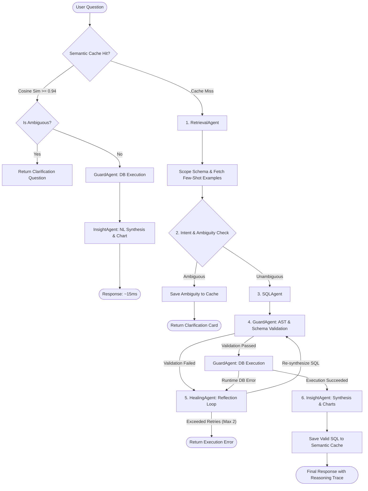

# QueryLens Multi-Agent System Architecture (`AGENTS.md`)

This document provides a comprehensive system design specification for the multi-agent architecture powering **QueryLens**. It details the orchestration lifecycle, individual agent contracts, guardrail boundaries, and step-by-step developer instructions for extending the system.

---

## 1. Executive System Overview

QueryLens is an enterprise-grade Natural Language to SQL (Text-to-SQL) and data intelligence platform. Rather than relying on a single, monolithic LLM prompt—which suffers from hallucinations, high token costs, and catastrophic write operations—QueryLens employs a **deterministic, multi-agent state-machine pipeline**.

### Core Design Principles
1. **Deterministic Guardrails Over Pure Generation**: Generative models propose queries; deterministic compilers (`sqlglot`) and database transaction engines validate and gate them.
2. **Context Minimization via Hybrid RAG**: Full database schemas are never dumped into prompts blindly. Local hybrid retrieval (Vector + BM25 keyword matching + FlashRank reranking) scopes context to only relevant tables and few-shot golden examples.
3. **Zero-Cost Fast Path via Semantic Vector Cache**: Paraphrased queries hit an in-memory vector cache, dropping repeat query latency to $\approx 15\text{ms}$ at $\$0$ LLM cost.
4. **Self-Healing Reflection Loops**: Validation or database execution errors are fed back into a bounded diagnosis loop to self-repair queries before failing to the user.

---

## 2. End-to-End Orchestration Topology



---

## 3. The Shared State Machine (`AgentState`)

All agents communicate exclusively through mutations of the typed `AgentState` dataclass (`app/agents/state.py`). No agent directly invokes another agent; execution order is governed strictly by the `AgentOrchestrator`.

```python
@dataclass
class AgentState:
    # 1. Input & Context
    question: str
    connection_id: int | None
    engine: Engine
    trace_id: int | None = None

    # 2. Routing & Ambiguity Detection
    is_ambiguous: bool = False
    clarification_question: str | None = None
    is_cache_hit: bool = False
    cache_similarity: float = 0.0

    # 3. RAG Retrieval & Context
    retrieved_tables: list[str] = field(default_factory=list)
    golden_queries: list[dict[str, str]] = field(default_factory=list)
    retrieval_ms: float = 0.0

    # 4. SQL Synthesis & Safety Gating
    sql: str | None = None
    is_valid_sql: bool = False
    validation_errors: list[str] = field(default_factory=list)

    # 5. Reflection & Self-Healing
    self_corrected: bool = False
    retry_count: int = 0
    repair_history: list[dict[str, str]] = field(default_factory=list)

    # 6. Database Execution Results
    columns: list[str] = field(default_factory=list)
    rows: list[dict[str, Any]] = field(default_factory=list)
    row_count: int = 0
    execution_ms: float = 0.0
    execution_error: str | None = None

    # 7. Synthesis & Visualization
    answer: str | None = None
    chart_recommendation: dict[str, Any] | None = None

    # 8. Observability & Telemetry
    step_latencies: dict[str, float] = field(default_factory=dict)
    llm_responses: list[LLMResponse] = field(default_factory=list)
```

---

## 4. Specialized Agent Roster & Contracts

| Agent | Engine / Technology | Input Dependencies | Output / State Mutation | Fallback Behavior |
|---|---|---|---|---|
| **Semantic Cache** | FastEmbed + Cosine Sim | `question`, `connection_id` | `is_cache_hit`, `sql` | Falls through to full agent pipeline |
| **`RetrievalAgent`** | FastEmbed + FlashRank Reranker | `question`, `engine` | `retrieved_tables`, `golden_queries` | Retains full database schema snapshot |
| **`AmbiguityDetector`** | LLM (Scoped Prompt) | `question`, `retrieved_tables` | `is_ambiguous`, `clarification_question` | Fails safe (`is_ambiguous=False`) |
| **`SQLAgent`** | LLM (PostgreSQL Dialect) | `question`, `retrieved_tables`, `golden_queries` | `sql` | Logs warning; triggers healing |
| **`GuardAgent`** | `sqlglot` AST Parser + PostgreSQL | `sql`, `engine` | `is_valid_sql`, `rows`, `columns`, `execution_error` | Passes error diagnostics to `HealingAgent` |
| **`HealingAgent`** | LLM (Error Reflection) | `validation_errors` or `execution_error` | `sql`, `self_corrected`, `retry_count` | Caps at 2 retries; halts execution safely |
| **`InsightAgent`** | Heuristic Sampler + LLM | `columns`, `rows`, `question` | `answer`, `chart_recommendation` | Defaults to tabular data presentation |

---

## 5. In-Depth Agent Specifications

### 5.1 RetrievalAgent (`app/agents/retrieval_agent.py`)
- **Role**: Solves the Schema Linking challenge. In databases with 50+ tables, including every table and column in the LLM context blows the token budget and introduces distractors.
- **Algorithm**:
  1. Computes 384-dimensional dense vectors using local CPU-friendly FastEmbed (`bge-small-en-v1.5`).
  2. Runs sparse keyword token matching against pre-tokenized table and column sets.
  3. Fuses dense and sparse rankings using Reciprocal Rank Fusion (RRF).
  4. Applies a local neural reranking cross-encoder (`FlashRank`) to pick the top-K relevant tables ($K=5$) and relevant few-shot examples ($K=2$).
- **Complexity**: $O(T \cdot D)$ embedding dot-products, executed in $\approx 15\text{ms}$ on CPU without external API calls.

### 5.2 AmbiguityDetector (`app/core/ambiguity.py`)
- **Role**: Identifies underspecified or structurally ambiguous business queries before generating code (e.g. *"Show active accounts"* without specifying whether activity means logged in, subscribed, or paid).
- **Optimization**: Evaluates ambiguity against **only** the tables returned by the `RetrievalAgent`.
- **Output**: Returns a user-friendly clarification prompt (`clarification_question`) rather than guessing user intent.

### 5.3 SQLAgent (`app/agents/sql_agent.py`)
- **Role**: Generates standard SQL matching target dialect conventions (PostgreSQL).
- **Context Injected**:
  - Scoped table DDL with foreign key relationships.
  - Two high-quality few-shot examples retrieved by the RAG layer.
  - Strict system rules: `SELECT` statements only, no data modification (`INSERT`/`UPDATE`/`DELETE`), no DDL.

### 5.4 GuardAgent (`app/agents/guard_agent.py`)
- **Role**: Deterministic security and schema integrity verification. Pure Python/AST compiler verification with zero LLM hallucinations.
- **Verification Gates**:
  1. **Grammar & Parser Validation**: Must parse into exactly 1 valid PostgreSQL AST statement via `sqlglot`.
  2. **Operation Whitelist**: Rejects any statement that is not `exp.Select` (drops, deletes, alters, updates, inserts are blocked).
  3. **Schema Whitelist**: Asserts that every referenced table and column exists in the database schema or is a defined alias in the query's `SELECT` clause.
  4. **Row Bounds**: Injects `LIMIT 200` into the AST if omitted.
  5. **Runtime Transaction Security**: Executes with `SET LOCAL statement_timeout = 5000;` and `SET LOCAL default_transaction_read_only = on;` to prevent runaway Cartesian joins or stored-procedure side-effects.

### 5.5 HealingAgent (`app/agents/healing_agent.py`)
- **Role**: Autonomous reflection and self-correction.
- **Trigger**: Activates if `GuardAgent` flags an AST/schema validation error (e.g., hallucinated column name) or the database returns an execution error (e.g., division by zero, type mismatch).
- **Behavior**:
  - Packages the failed SQL, exact compiler/database error message, and scoped schema.
  - Prompts the LLM to diagnose the root cause and provide a corrected query.
  - Re-routes the repaired SQL through `GuardAgent`.
  - Bounded by `max_self_healing_retries = 2` to eliminate infinite loops.

### 5.6 InsightAgent (`app/agents/insight_agent.py`)
- **Role**: Data synthesis and automatic visualization mapping.
- **Chart Inference Algorithm**:
  - Deterministically samples the first 5 non-null rows of the result set.
  - Detects date/time axes + numeric metrics $\rightarrow$ **Line Chart** (`Recharts`).
  - Detects categorical labels + numeric metrics ($\le 6$ rows) $\rightarrow$ **Pie Chart**.
  - Detects categorical labels + numeric metrics ($> 6$ rows) $\rightarrow$ **Bar Chart**.
  - Handles Python `Decimal`, floats, integers, and negative values.
  - Generates a concise, executive natural language answer summarizing the data findings.

---

## 6. Security & Safety Model

```
+--------------------------------------------------------------------------+
|                            Security Perimeters                          |
+--------------------------------------------------------------------------+
| 1. Fernet Encryption       | Connection strings encrypted at rest in DB. |
| 2. Pydantic Input Guards   | Strict payload typing and validation.       |
| 3. Read-Only AST Whitelist | Pure SELECT enforcement via sqlglot.        |
| 4. Schema Binding          | Blocks access to non-existent schema objects|
| 5. DB Read-Only Session    | 'SET LOCAL default_transaction_read_only'   |
| 6. Timeout Gate            | 'SET LOCAL statement_timeout = 5000'        |
| 7. Memory Row Cap          | Cursor bounded via fetchmany(500)           |
+--------------------------------------------------------------------------+
```

---

## 7. Developer Guide: How to Add a New Agent

Follow this standard procedure to add a new specialized agent to QueryLens.

### Step 1: Implement the Agent Protocol
Create a new file in `backend/app/agents/<agent_name>_agent.py`. The agent must adhere to the `Agent` protocol defined in `backend/app/agents/base.py`:

```python
"""
Summary: Specialist agent that detects statistical anomalies in query results.
"""
import time
from app.agents.state import AgentState
from app.observability.logger import get_logger

logger = get_logger(__name__)


class AnomalyAgent:
    """Detects statistical anomalies or outliers in numeric query result rows."""

    def __init__(self, sensitivity_threshold: float = 2.5) -> None:
        self.threshold = sensitivity_threshold

    def run(self, state: AgentState) -> AgentState:
        # 1. Guard against preconditions
        if not state.is_valid_sql or state.execution_error or not state.rows:
            return state

        start = time.monotonic()

        # 2. Perform agent task
        anomalies = []
        # (Inspection logic here...)

        # 3. Mutate state with results & record latency
        elapsed = (time.monotonic() - start) * 1000
        state.step_latencies["anomaly_detection_ms"] = elapsed
        logger.info("AnomalyAgent completed in %.2fms", elapsed)
        return state
```

### Step 2: Extend `AgentState`
If your agent produces new domain fields, add them to `backend/app/agents/state.py`:

```python
# In AgentState:
anomalies_detected: list[str] = field(default_factory=list)
```

### Step 3: Wire into `AgentOrchestrator`
Register your agent in `backend/app/agents/orchestrator.py`:

```python
# In AgentOrchestrator.__init__:
self.anomaly_agent = AnomalyAgent()

# In AgentOrchestrator.execute_pipeline:
# Insert at the appropriate lifecycle stage:
if state.is_valid_sql and state.execution_error is None:
    state = self.anomaly_agent.run(state)
    state = self.insight_agent.run(state)
```

### Step 4: Write Unit Tests
Add unit tests in `backend/tests/test_agents.py` using mock database states to assert that your agent mutates `AgentState` as expected under both normal and edge-case conditions.

---

## 8. Performance & Token Economics

| Metric | Monolithic Baseline | QueryLens Agentic Pipeline | QueryLens Cache Hit |
|---|---|---|---|
| **Input Tokens (100 Tables)** | $\approx 4,800$ tokens | $\approx 650$ tokens (**86% reduction**) | $0$ tokens (**100% reduction**) |
| **LLM Calls (Cache Miss)** | 2 calls (Ambiguity + SQL) | 1 scoped ambiguity + 1 scoped SQL | 0 calls |
| **End-to-End Latency** | $2,200\text{ms}$ | $850\text{ms} - 1,100\text{ms}$ | $\mathbf{\approx 15\text{ms}}$ |
| **Halts Destructive SQL** | Inconsistent (Prompt rule only) | **100% Guaranteed** (AST compiler) | **100% Guaranteed** |
